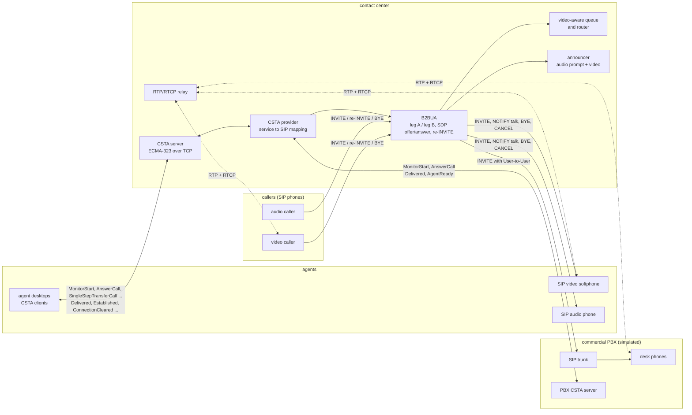

# sip-video-cc

A video contact center on SIP, integrated with the standard CSTA contact-center protocol: SDP offer/answer for audio and video, RTP media handling and a CSTA interface for call control and agent desktops.


See also: [sip-contact-center](https://github.com/pgallo/sip-contact-center), the voice side of the same story (a SIP stack with the full RFC 3261 transaction layer, registrar and proxy, skills-based ACD, IVR and call detail records, plus an adapter for open-source PBX manager interfaces).

## What it demonstrates

- **A back-to-back user agent that anchors media**: callers' INVITEs are answered by the B2BUA, which plays a queue announcement (audio prompt plus a video stream) and later opens a second leg to the chosen agent. RTP and RTCP are relayed unchanged between the legs, so SSRCs and sender-report clocks stay end to end.
- **SDP offer/answer for audio and video** (RFC 3264): codec negotiation over static payload types treated as opaque (PCMU 0, PCMA 8, H.261 31, H.263 34), rejected streams kept as port-0 m-lines, re-INVITE to add or remove video mid-call, and hold through `sendonly` / `recvonly` directions propagated from one leg to the other.
- **RTP and RTCP** (RFC 3550): packetisation of synthetic frames with marker bits, sequence and timestamp handling across wrap, an adaptive jitter buffer with late, concealed and incomplete-frame counters, receiver statistics (loss, fraction lost, interarrival jitter per Appendix A.8), SR/RR exchange with round-trip time from LSR/DLSR, and lip sync that maps each stream's RTP timestamps to the sender's wallclock through its SR and holds back the earlier stream.
- **CSTA as the third-party call control interface** (ECMA-269 services encoded in ECMA-323 XML over TCP): MonitorStart, MakeCall, AnswerCall, ClearConnection, SingleStepTransferCall and SetAgentState, with Delivered, Established, ConnectionCleared, AgentReady and AgentNotReady events. Each service is mapped onto SIP in the B2BUA: AnswerCall becomes a remote-answer NOTIFY (`Event: talk`), ClearConnection a BYE on both legs (CANCEL if the agent is still ringing), SingleStepTransferCall a BYE to the old agent and an INVITE to the new one, MakeCall an auto-answer INVITE to the agent followed by an INVITE to the destination.
- **Integration with open-source and commercial telephony platforms**: commercial PBX platforms are integrated through CSTA. Agents whose desk phones live on such a PBX are reached over a SIP trunk, and the contact center controls and observes them through the PBX's own CSTA interface (it monitors the PBX devices, correlates trunk calls with user-to-user data, and forwards AnswerCall). A simulated PBX with its own CSTA server stands in for one in tests and the demo. Open-source PBX manager interfaces are covered by the companion repository.
- **Video-aware routing**: video callers go to the longest-idle video-capable agent; after a configurable wait, or immediately if no video agent is logged on, they fall back to an audio agent and the caller's video is dropped by re-INVITE. A later transfer to a video agent adds it back.
- **A deterministic simulation**: SIP, media and timers run on one discrete-event scheduler with virtual time, the network applies per-path delay, jitter, loss and extra video delay, and CSTA traffic goes over real loopback TCP sockets that are pumped between scheduler steps.

## Architecture



`ContactCenter` is at the same time the SIP endpoint for every leg and the `CstaProvider` behind a `CstaServer`. Inbound calls are answered on leg A and queued; the router picks an agent and the B2BUA opens leg B with an offer that includes video only if both sides can use it. The ringing response produces a Delivered event for whoever monitors that agent, and the desktop's AnswerCall is turned into SIP: a NOTIFY with `Event: talk` for SIP phones, or an AnswerCall forwarded over the CSTA link to the PBX when the agent's phone lives there. Once leg B answers, the B2BUA re-INVITEs leg A if the video state differs, then wires the relay. Media endpoints (`MediaSession`) carry one audio and one video `MediaStream`, each with a packetizer, receiver statistics, jitter buffer and an RTCP timer; lip sync sits on top of the pair. Everything in the SIP and media planes runs on `Scheduler` in virtual time, so a 45-second scenario with about 14,000 media packets completes in a fraction of a second.

## Quickstart

Requires a C++17 compiler, CMake 3.16 or newer and `libgtest-dev` (the only dependency, used by the tests).

```bash
cmake -S . -B build -DCMAKE_BUILD_TYPE=Release
cmake --build build -j
ctest --test-dir build --output-on-failure   # unit, mapping and end-to-end tests, plus the demo as a gate
./build/svcc_demo                            # or ./scripts/demo.sh
```

Excerpt of the demo output:

```
[   1.006s] C1 offered to 2001 (Ana): INVITE with audio+video
[   2.510s] C1 AnswerCall(2001) mapped to NOTIFY Event: talk
[   2.514s] C1 answered by 2001 with video
[   6.506s] C1 re-INVITE from 2001 (sendonly, video) propagated to the other leg
[   8.006s] C2 no video agent within 5 s: falling back to audio agent 3001
[   8.010s] C2 PBX reports DeliveredEvent P1 at 3001 (correlated by user-to-user data)
[   9.515s] C2 AnswerCall(3001) forwarded to the PBX as AnswerCall(P1)
[   9.517s] C2 re-INVITE to caller: drop video (agent has none)
[  13.515s] C1 SingleStepTransferCall 2001 -> 2002: BYE to the old agent, INVITE to the new one
[  15.024s] C1 re-INVITE to caller: drop video (agent has none)
[  34.000s] C4 MakeCall(2001 -> 5550100): INVITE to the agent phone with answer-after=0

== CSTA events received by agent desktops (ECMA-323 over TCP) ==
[   1.010s] 2001 <- DeliveredEvent call C1 at 2001 from caller1 [video]
[   2.515s] 2001 <- EstablishedEvent call C1 answered by 2001 [video]
[  13.515s] 2001 <- ConnectionClearedEvent call C1 dropped 2001 (transferred)
[  13.520s] 2002 <- DeliveredEvent call C1 at 2002 from caller1 [voice]

== RTCP and jitter buffer, call C1 at t=12.5 s (before the transfer) ==
  agent 2001 audio PCMU sent  499 recv  440 lost  9 jitter 12.0 ms | far end: lost  6 jitter 10.0 ms | rtt 87.2 ms | buffer: late  7 concealed 16 incomplete 14 delay  80 ms
  agent 2001 video H263 sent  405 recv  367 lost  9 jitter  9.9 ms | far end: lost  3 jitter 12.1 ms | rtt 87.8 ms | buffer: late  0 concealed  8 incomplete  4 delay  40 ms

== lip sync at agent 2001 ==
  A/V offset before correction: +34.7 ms (video later than audio)
  audio held back by:           34.7 ms
  A/V offset after correction:  -0.8 ms

== call records ==
  call  from      dir  video offered/at answer  agents     transfers  video re-INVITEs  answered  outcome
  C1    caller1   in   yes / yes                2001,2002          1                 1      2.5s  completed
  C2    caller2   in   yes / no                 3001               0                 1      9.5s  completed
  C3    caller3   in   no / no                  2001               0                 0     17.5s  completed
  C4    2001      out  - / yes                  2001               0                 0     34.0s  completed

all demo checks passed
```

The demo checks its own outcome (routing decisions, video state after each transfer, lip-sync correction, no rejected CSTA requests) and exits non-zero on failure; `ctest` runs it as `demo_scenario`.

## Design decisions

1. **A B2BUA that anchors media, rather than a proxy that lets endpoints talk directly.**
   *Why:* a video contact center has to play announcements before an agent is chosen, switch the caller between agents with different capabilities, and know what each leg negotiated. Owning both legs makes the caller's dialog stable across transfers (the caller never sees the agent change except through a re-INVITE that changes media), keeps signalling from agents' phones away from the public side, and lets the contact center apply its own codec and video policy per leg. Relaying RTP and RTCP unchanged keeps SSRCs and SR clocks end to end, so receiver statistics and lip sync work as if the endpoints were connected directly.
   *Trade-off:* every media packet crosses the B2BUA, which costs latency and capacity (the demo relays about 6,000 packets for four short calls). A production design would relay only when needed (announcements, recording, NAT) and otherwise re-INVITE the endpoints towards each other.

2. **CSTA services are mapped onto SIP primitives the phones already understand.**
   *Why:* third-party call control has to work with phones that only speak SIP. AnswerCall is the hard one, because a SIP phone cannot be made to answer by its callee's network; the mapping uses the remote-answer convention of a NOTIFY with `Event: talk` inside the early dialog, and an `answer-after=0` Call-Info parameter for MakeCall, where the agent's own phone is the first leg. ClearConnection becomes BYE or CANCEL depending on whether the leg answered, and SingleStepTransferCall reuses the normal offer path so routing, video alignment and events stay in one place.
   *Trade-off:* the remote-answer conventions are widely implemented but not universal. A phone that ignores them leaves AnswerCall ineffective; the code would need a per-device capability flag and a fallback (for example, asking the agent to pick up).

3. **Commercial PBXs are integrated through CSTA plus a SIP trunk, not through a second call model.**
   *Why:* contact centers rarely own every agent's phone; many agents sit on a PBX whose devices are controlled through that PBX's CSTA interface. Keeping media and signalling on a SIP trunk while using the PBX's CSTA link only for control and observation means the B2BUA logic is identical for both kinds of agent; only AnswerCall differs. The trunk call carries the contact-center call id as user-to-user data, which the PBX echoes as `correlatorData` in its Delivered event, so the two call identities are joined without guessing.
   *Trade-off:* correlation depends on the PBX passing user-to-user data through to CSTA, and agent readiness for PBX agents comes from PBX events, so the two systems can briefly disagree about an agent's state. The simulated PBX implements just enough CSTA to exercise these paths.

4. **Video-aware routing with a bounded wait, then fallback by re-INVITE.**
   *Why:* a video caller should reach a video-capable agent when one exists, but not wait indefinitely for one. The router therefore prefers video agents for video callers, falls back to any agent after `videoFallbackWait` (or at once when no video agent is logged on), and audio callers prefer audio agents so video seats stay free. The caller keeps the video m-line with port 0 after a fallback, so a later transfer to a video agent can turn video back on in the same dialog.
   *Trade-off:* the policy is fixed (longest idle within the preferred pool). Queues, skills and service levels are deliberately left to the companion repository; here routing exists to exercise media capability decisions.

5. **Virtual time for SIP and media, real sockets for CSTA, pumped in lockstep.**
   *Why:* jitter-buffer adaptation, RTCP intervals and lip sync are only testable if timing is exact and repeatable, so the SIP and media planes run on a discrete-event scheduler with seeded loss and jitter. CSTA is the integration surface, so it uses real TCP, carrying ECMA-323 XML in length-prefixed frames; the harness polls all CSTA endpoints until they are quiet before advancing virtual time, which keeps request and event ordering deterministic. The same 45-second scenario produces the same packets on every run, and the whole test suite runs in well under a second.
   *Trade-off:* the in-process SIP network is reliable and ordered, so there are no SIP retransmission timers here; the companion Java repository covers the RFC 3261 transaction layer over UDP. Timing on real networks also includes clock drift between endpoints, which the simulation does not model.

6. **Lip sync from SR mappings, corrected by delaying the earlier stream.**
   *Why:* audio and video travel as separate RTP streams with unrelated timestamp bases and, here, different network paths. Each SR pairs an NTP wallclock with an RTP timestamp, so the receiver can compute, for every played frame, the end-to-end delay from capture to presentation. The smoothed difference between video and audio delays is the A/V offset; the correction adds that amount to the audio jitter buffer (or the video one if audio is late), trading a little latency for alignment. In the demo the offset drops from about 35 ms to under 1 ms.
   *Trade-off:* the correction is applied once, on request, rather than as a continuous control loop, and it assumes the sender's audio and video share one wallclock, which is true for a single device but not for a mixer.

## Scope and limits

- No real codecs: frames are synthetic byte arrays of plausible size (G.711 frames every 20 ms, 15 fps video with periodic larger key frames), identified only by payload type.
- SIP is a minimal subset over an in-process network: no transaction timers, no Via-based routing, no authentication, no forking, no PRACK, no SRTP or ICE.
- RTCP covers SR and RR only (no SDES, BYE or feedback messages); compound packets are not built.
- CSTA covers the listed services and events. There is no snapshot, no call history, no conference or consultation call, and no security on the TCP link.
- The simulated PBX models ringing, answering and clearing desk phones only; it is a test double for the integration path, not a PBX.
- All names, numbers and traffic are synthetic.

## About this lab

A compact reference implementation written in 2026. It reconstructs the approach behind a video contact center I built in 2001, with SIP integrated with standard contact-center protocols, without reproducing any proprietary design.

## License

MIT, see [LICENSE](LICENSE).
